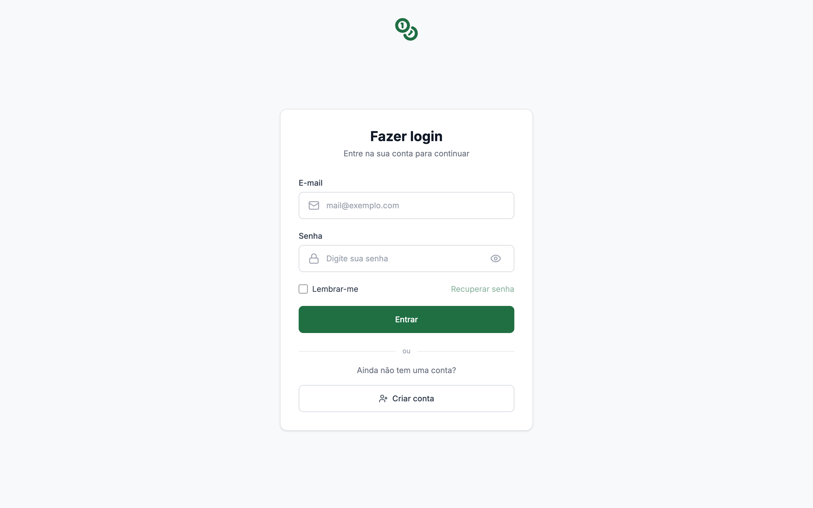
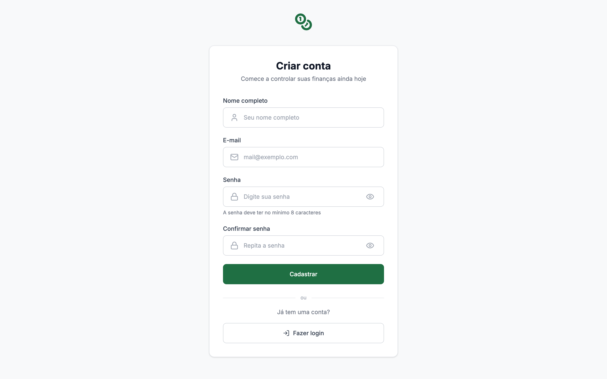
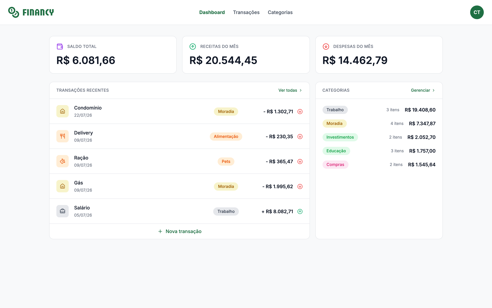
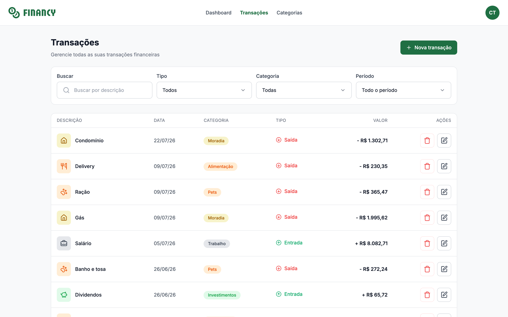
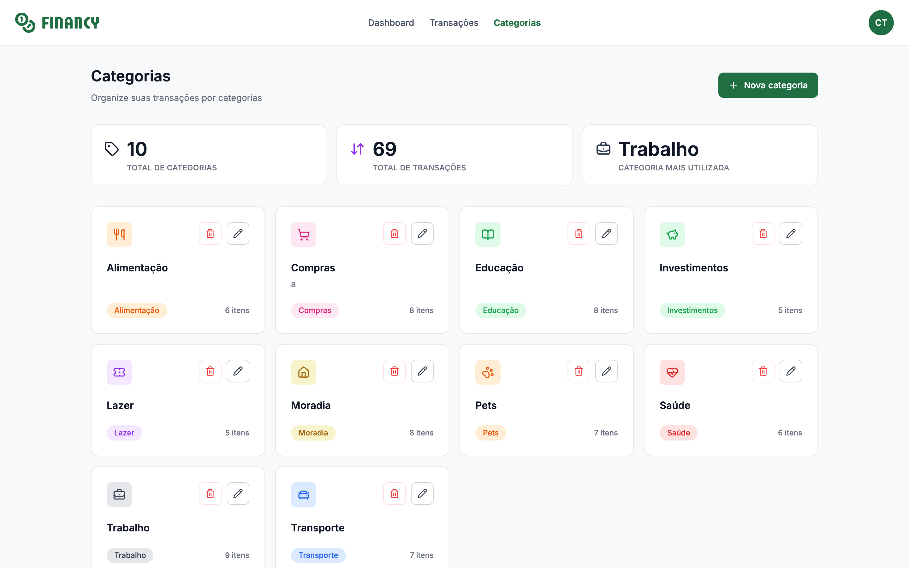
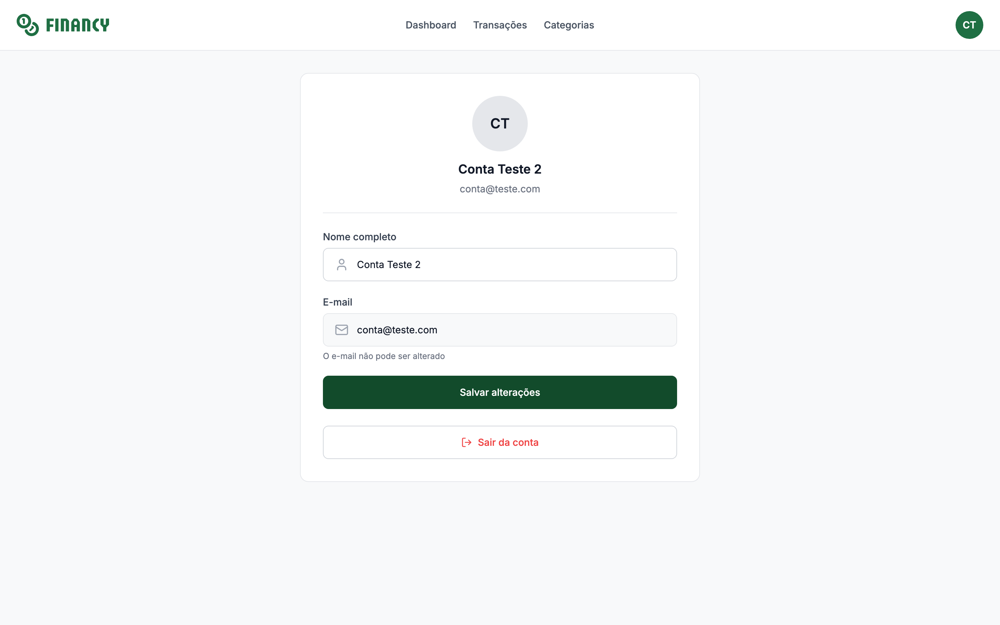

# Financy

Aplicação completa de gestão de finanças pessoais — exercício final da Pós-Tech
Rocketseat. Permite cadastrar transações e categorias, fazer login com
e-mail/senha, ver um dashboard mensal e gerenciar o próprio perfil.

```
financy/
├── backend/    # API GraphQL (Node + Apollo + TypeGraphQL + Prisma + SQLite)
└── frontend/   # SPA (React 19 + Vite + Apollo Client + Tailwind v4)
```

## Telas

| Login | Cadastro |
| --- | --- |
|  |  |

| Dashboard | Transações |
| --- | --- |
|  |  |

| Categorias | Perfil |
| --- | --- |
|  |  |

## Quickstart

Em dois terminais, na ordem:

```bash
# 1) backend
cd backend
pnpm install
cp .env.example .env                # defina JWT_SECRET
pnpm migrate                        # cria ./dev.db
pnpm seed                           # popula com 1 usuário + 10 categorias + 69 transações
pnpm dev                            # http://localhost:4000/graphql

# 2) frontend (em outro terminal)
cd frontend
pnpm install
cp .env.example .env                # VITE_API_URL já aponta pra :4000
pnpm codegen                        # gera src/gql/ a partir de ../backend/schema.graphql
pnpm dev                            # http://localhost:5173
```

Login de teste (criado pelo seed):

- **e-mail**: `conta@teste.com`
- **senha**: `senha123`

## Documentação por subprojeto

| Pasta    | README                                       | CLAUDE.md                                    |
| -------- | -------------------------------------------- | -------------------------------------------- |
| Backend  | [`backend/README.md`](./backend/README.md)   | [`backend/CLAUDE.md`](./backend/CLAUDE.md)   |
| Frontend | [`frontend/README.md`](./frontend/README.md) | [`frontend/CLAUDE.md`](./frontend/CLAUDE.md) |

Cada subprojeto também tem uma pasta `docs/` com o escopo detalhado de cada
tarefa (numeradas) — útil pra entender as decisões de implementação tarefa a
tarefa.

## Stack resumida

- **Tipo**: TypeScript em tudo, ESM, `pnpm`.
- **Backend**: Node 20+, Apollo Server 5, TypeGraphQL, Prisma 6, SQLite,
  Express 5, JWT (HS256, 1 dia).
- **Frontend**: React 19, Vite 7, Apollo Client 4, Tailwind CSS v4 com `@theme`,
  Zustand (persistido), React Hook Form + Zod, Radix UI, Lucide icons.
- **Qualidade**: Biome (lint + format), Vitest, MSW no frontend, Prisma + DB
  real no backend.

## Funcionalidades implementadas

- Cadastro e login com e-mail/senha; token JWT no `Authorization` header.
- Cada usuário só vê e gerencia os próprios dados (escopo enforced no backend).
- CRUD completo de categorias (nome, cor, ícone, descrição opcional).
- CRUD completo de transações com filtros (tipo, categoria, descrição) e
  paginação client-side.
- Dashboard com saldo, receitas e despesas do mês corrente, top-5 recentes,
  top-5 categorias mais movimentadas.
- Página de perfil com edição de nome (e-mail bloqueado), logout que limpa
  cache Apollo + store.
